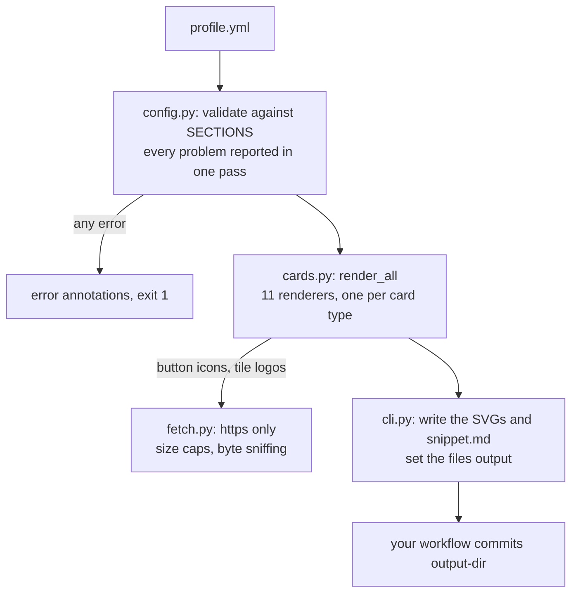

# readme-kit

[](https://github.com/Sagargupta16/readme-kit-action/actions/workflows/ci.yml)
[](https://github.com/marketplace/actions/readme-kit)
[](https://github.com/Sagargupta16/readme-kit-action/releases/latest)
[](LICENSE)

**One `profile.yml` in, a matching set of animated SVG cards out, committed to your own repo.**

readme-kit renders the cards a GitHub profile README is made of (hero, terminal, section
headers, timeline, tiles, panels, stats, project cards, buttons, divider, footer) in one
consistent design and writes them next to your README. Nothing is served by a third party
when someone views your profile, so nothing can rate-limit it or go down.

Why it exists: hosted README widgets run on free quotas. On 2026-09-23
github-profile-trophy and the GitHub activity graph both answered HTTP 402 on the profile
this design comes from, and those images broke. A card committed to your repo is just a file.

The look is the one on [github.com/Sagargupta16](https://github.com/Sagargupta16): dark,
840 pixels wide, one blue accent, CSS and SMIL animation. Every image below is rendered
from [`profile.example.yml`](profile.example.yml).

## Gallery

**hero** (`hero.svg`): name, rotating taglines, status pill, location, node constellation


**terminal** (`terminal.svg`): each command types itself out, then its output appears


**headers** (`header-<key>-dark.svg` and `header-<key>-light.svg`): numbered in profile order,
with a light variant for GitHub's light theme

<picture>
  <source media="(prefers-color-scheme: dark)" srcset="examples/header-experience-dark.svg">
  <source media="(prefers-color-scheme: light)" srcset="examples/header-experience-light.svg">
  
</picture>

**divider** (`divider.svg`)


**timeline** (`timeline.svg`): a rail of milestones; the last one can expand into a second
rail of dated items


**stats** (`stats.svg`): a four-column grid of values


**tiles** (`tiles.svg`): logos fetched at render time and inlined, or a monogram


**panels** (`panels.svg`): up to four titled lists in a 2x2 grid


**projects** (`project-<key>.svg`): one card per project, two per row

<p align="center">
<a href="https://kalchar.co.in/"></a>
<a href="https://chromewebstore.google.com/detail/gitscope/fndaanihifimmlnmkjdmjbbkbdajolff"></a>
<a href="https://sagargupta.online/ledger-sync/"></a>
<a href="https://github.com/Sagargupta16/Blue_Green_AWS_Terraform"></a>
</p>

**buttons** (`button-<key>.svg`): one per link, with a [simple-icons](https://simpleicons.org) glyph

<p align="center">
<a href="https://www.linkedin.com/in/sagar-gupta-16-10"></a>
<a href="https://leetcode.com/sagargupta1610/"></a>
<a href="https://sagargupta.online/portfolio-react/"></a>
<a href="mailto:sg85207@gmail.com"></a>
<a href="https://github.com/Sagargupta16"></a>
</p>

**footer** (`footer.svg`): rotating sign-off lines over an animated wave


## Quick start

1. Copy [`profile.example.yml`](profile.example.yml) to `profile.yml` in your profile repo
   (the one named after your username) and replace the data with yours. Delete any section
   you do not want; a missing section writes nothing.

2. Add `.github/workflows/readme-kit.yml`:

   ```yaml
   name: README cards

   on:
     push:
       paths: [profile.yml]
     workflow_dispatch:

   permissions:
     contents: write

   jobs:
     render:
       runs-on: ubuntu-latest
       steps:
         - uses: actions/checkout@v7

         - uses: Sagargupta16/readme-kit-action@v1

         - name: Commit the cards
           run: |
             git config user.name "github-actions[bot]"
             git config user.email "41898282+github-actions[bot]@users.noreply.github.com"
             git add assets/readme-kit
             if ! git diff --cached --quiet; then
               git commit -m "chore: render readme cards"
               git push
             fi
   ```

3. Push `profile.yml`. The cards land in `assets/readme-kit/`, together with `snippet.md`:
   the README markup for every card, in profile order. Paste what you need into README.md.

The action only writes files on the runner. Committing them is your workflow's job, as above.

## How it works



1. **Validate.** `config.py` holds the whole schema in `SECTIONS`. It checks every section
   before anything renders, fills in defaults, and resolves each card's file name.
2. **Fetch.** `fetch.py` is the only network code. It downloads simple-icons glyphs for
   buttons and logos for tiles, https only, with size caps and a check of the image bytes.
   A failed download is a warning, never a failed run.
3. **Render.** `cards.py` has one renderer per card type, built on the shared palette and
   SVG primitives in `svg.py`. Every profile string is HTML-escaped before it reaches an SVG.
4. **Write.** `cli.py` writes each SVG and `snippet.md` to `output-dir` and sets the
   `files` output. Your workflow decides what gets committed.

Design decisions:

- **Committed files, not hosted widgets.** Hosted widgets broke on this profile with HTTP 402
  on 2026-09-23. A file in your repo has no quota.
- **Standard library plus one pinned wheel.** PyYAML is the only dependency, so there is
  little to audit and nothing to build on the runner.
- **CSS and SMIL animation only.** GitHub shows README images through ``, where scripts
  never run, so the cards animate without any.
- **Offline tests.** The test suite blocks the network and feeds canned bytes to every
  download, so a CDN outage cannot turn CI red. The `action` CI job covers the live path.

## Using the cards in your README

Full-width cards go in at `width="100%"`. Section headers use a `<picture>` so GitHub picks
the variant that matches the viewer's theme:

```html


<picture>
  <source media="(prefers-color-scheme: dark)" srcset="assets/readme-kit/header-experience-dark.svg">
  <source media="(prefers-color-scheme: light)" srcset="assets/readme-kit/header-experience-light.svg">
  
</picture>

<p align="center">
<a href="https://kalchar.co.in/"></a>
<a href="https://github.com/Sagargupta16"></a>
</p>
```

- An image cannot carry a link, so wrap buttons and project cards in `<a>`. `snippet.md` does
  this for you from each entry's `url`.
- Size buttons by `height="44"`, not by width: a long label makes a wider button, and a
  percentage width would shrink it.
- Project cards are 410 wide, so two at `width="49%"` fill a row.

## Inputs

| Input | Default | Description |
| --- | --- | --- |
| `config` | `profile.yml` | Path to the profile YAML file |
| `output-dir` | `assets/readme-kit` | Directory the SVGs and `snippet.md` are written to |

## Outputs

| Output | Description |
| --- | --- |
| `files` | Number of files written to `output-dir`: every SVG plus `snippet.md` |

## Profile reference

Every top-level section is optional and renders only when present. Set one to `false` to
switch it off without deleting it. [`profile.example.yml`](profile.example.yml) documents
every key in place; required keys are in bold below.

| Section | Writes | Keys |
| --- | --- | --- |
| `theme` | nothing | `accent`: a `#rrggbb` color that replaces the blue family on every card |
| `hero` | `hero.svg` | **`name`**, `kicker`, `role` (alt text only: read out by screen readers, not drawn), `taglines` (up to 12), `status`, `location`, `constellation`: **`hub`** and `nodes` (up to 5), each label at most 5 characters |
| `terminal` | `terminal.svg` | `prompt`, `title`, **`commands`**: **`command`**, `output` (lines), `color` |
| `headers` | `header-<key>-dark.svg`, `header-<key>-light.svg` | a list of **`title`**, `subtitle`, `key` |
| `divider` | `divider.svg` | `true` |
| `footer` | `footer.svg` | `kicker`, **`lines`** (up to 12) |
| `timeline` | `timeline.svg` | `title`, **`milestones`** (2 to 6): **`year`**, **`title`**, `subtitle`, `tag`; `expand`: `title`, **`items`** (1 to 6): **`when`**, **`title`**, `subtitle` |
| `tiles` | `tiles.svg` | `title`, **`items`** (1 to 6): **`name`**, `subtitle`, `logo` (https image URL) |
| `panels` | `panels.svg` | `title`, **`items`** (1 to 4): **`title`**, `color`, **`entries`**: **`text`**, `year` |
| `stats` | `stats.svg` | a list of **`value`**, **`label`**, `color` |
| `buttons` | `button-<key>.svg` | a list of **`label`**, `icon` (simple-icons slug), `url` (https or mailto), `key` |
| `projects` | `project-<key>.svg` | a list of **`title`**, **`description`**, `date`, `tech`, `live` (true or false), `url`, `key` |

- `color` is one of `accent`, `sky`, `green` or `amber`.
- `key` names the file. It defaults to the title (or label) in lowercase with hyphens, so
  `Ledger Sync` becomes `project-ledger-sync.svg`. Keys must be unique within a section.
- Numbers and dates are read as text, so `year: 2021` works. YAML reads `yes`, `no`, `on`
  and `off` as booleans, so quote them when you mean the word.
- All text is HTML-escaped. En and em dashes become plain hyphens.

## Validation

The profile is checked before anything is written. Every problem is reported in one pass,
each naming the key, and the run exits 1:

```text
error: profile.yml: hero.tagline: unknown key, did you mean 'taglines'?
error: profile.yml: tiles.items[0].logo: 'http://dtcc.com/logo.png' must be a URL starting with https://
error: profile.yml: buttons[0].icon: 'Git Hub' is not a simple-icons slug such as 'linkedin'
```

Inside Actions the same lines are `::error::` annotations on the run.

## Scope

What v1 does not do, so you know before you install it:

- **One design.** `theme.accent` is the only theming knob. It replaces the blue family;
  sky, green and amber stay. Green marks live and current items, so a green accent blurs
  that signal.
- **Dark first.** Headers ship a light variant. The other cards bring their own dark
  background, except the footer, whose light text is drawn for GitHub's dark theme and
  reads poorly on the light one.
- **No live data.** Every number is what you type into the profile. Nothing fetches
  GitHub or LeetCode stats.
- **Text is not measured.** The limits that would break a layout are enforced (5-character
  node labels, 6 tiles, 6 milestones, 4 panels); an unusually long name or tagline can
  still overflow its card.
- **It never edits README.md**, and it does not delete a card you removed from the
  profile. Clear `output-dir` yourself when you rename a key.

## Security

- **No token, no secrets.** The action needs no permissions beyond what your commit step uses.
- **Two kinds of download, both https only**, checked before a connection opens:
  simple-icons glyphs from `cdn.jsdelivr.net/npm/simple-icons@latest`, and the tile `logo`
  URLs you list. A redirect off https is refused, a logo over 256 KB is refused, and a logo
  must be a PNG, JPEG, GIF, WebP or SVG by its bytes. A failed download never fails the
  run: the button is drawn without its icon, the tile gets a monogram, and a warning names
  the key. simple-icons is read at `@latest`, so a slug that project removes turns into
  that warning.
- **Escaped text.** Every string from the profile is HTML-escaped before it reaches an SVG,
  and characters XML forbids are dropped.
- **Pinned dependency.** Python standard library plus PyYAML 6.0.3, installed as a pinned
  wheel (`--only-binary :all:`) and read with `yaml.safe_load`.
- **Self-contained output.** No scripts, no external fonts or images, CSS and SMIL
  animation only. GitHub serves README images through ``, where scripts never run.

Pin the action to a full commit SHA and keep the version in a trailing comment:

```yaml
- uses: Sagargupta16/readme-kit-action@<full-commit-sha> # v1.0.0
```

## Development

The tests need no network: every download is replaced by canned bytes.

```bash
# tests
uv run --no-project --with pytest==9.1.1 --with pyyaml==6.0.3 pytest -v

# lint (ruff's full default ruleset, no config)
uvx ruff@0.17.1 check .

# re-render the gallery after changing a card or the example profile
uv run --no-project --with pyyaml==6.0.3 python readme_kit.py --config profile.example.yml --output-dir examples
```

CI runs ruff on Python 3.13, pytest on 3.12, 3.13 and 3.14, and a third job that runs
`action.yml` itself on `profile.example.yml` with live downloads. That job fails if the
`files` output does not match what is on disk, if any SVG does not parse, if a button
came out without its icon, or if `examples/` no longer holds the same set of cards.

## License

[MIT](LICENSE)
