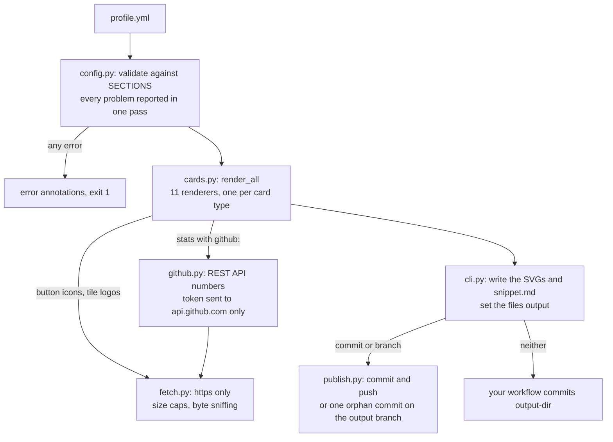

# readme-kit

[](https://github.com/Sagargupta16/readme-kit-action/actions/workflows/ci.yml)
[](https://github.com/marketplace/actions/readme-kit)
[](https://github.com/Sagargupta16/readme-kit-action/releases/latest)
[](LICENSE)

**One `profile.yml` in, a matching set of animated SVG cards out, committed to your own repo.**

readme-kit renders the cards a GitHub profile README is made of (hero, terminal, section
headers, timeline, tiles, panels, stats, project cards, buttons, divider, footer) in one
consistent design and writes them next to your README. Nothing is served by a third party
when someone views your profile, so nothing can rate-limit it or go down.

Why it exists: hosted README widgets run on free quotas. On 2026-09-23
github-profile-trophy and the GitHub activity graph both answered HTTP 402 on the profile
this design comes from, and those images broke. A card committed to your repo is just a file.

The look is the one on [github.com/Sagargupta16](https://github.com/Sagargupta16): dark,
840 pixels wide, one blue accent, CSS and SMIL animation. Every image below is rendered
from [`profile.example.yml`](profile.example.yml).

## Gallery

**hero** (`hero.svg`): name, rotating taglines, status pill, location, node constellation



**terminal** (`terminal.svg`): each command types itself out, then its output appears



**headers** (`header-<key>-dark.svg` and `header-<key>-light.svg`): numbered in profile order,
with a light variant for GitHub's light theme

<picture>
  <source media="(prefers-color-scheme: dark)" srcset="examples/header-experience-dark.svg">
  <source media="(prefers-color-scheme: light)" srcset="examples/header-experience-light.svg">
  
</picture>

**divider** (`divider.svg`)


**timeline** (`timeline.svg`): a rail of milestones; the last one can expand into a second
rail of dated items



**stats** (`stats.svg`): a four-column grid of values


**tiles** (`tiles.svg`): logos fetched at render time and inlined, or a monogram



**panels** (`panels.svg`): up to four titled lists in a 2x2 grid



**projects** (`project-<key>.svg`): one card per project, two per row

<p align="center">
<a href="https://kalchar.co.in/"></a>
<a href="https://chromewebstore.google.com/detail/gitscope/fndaanihifimmlnmkjdmjbbkbdajolff"></a>
<a href="https://sagargupta.online/ledger-sync/"></a>
<a href="https://github.com/Sagargupta16/terraform-aws-ecs-blue-green"></a>
</p>

**buttons** (`button-<key>.svg`): one per link, with a [simple-icons](https://simpleicons.org) glyph

<p align="center">
<a href="https://www.linkedin.com/in/sagar-gupta-16-10"></a>
<a href="https://leetcode.com/sagargupta1610/"></a>
<a href="https://sagargupta.online/portfolio-react/"></a>
<a href="mailto:sg85207@gmail.com"></a>
<a href="https://github.com/Sagargupta16"></a>
</p>

**footer** (`footer.svg`): rotating sign-off lines over an animated wave


## Quick start

1. Copy [`profile.example.yml`](profile.example.yml) to `profile.yml` in your profile repo
   (the one named after your username) and replace the data with yours. Delete any section
   you do not want; a missing section writes nothing.

2. Add `.github/workflows/readme-kit.yml`:

   ```yaml
   name: README cards

   on:
     push:
       paths: [profile.yml]
     schedule:
       - cron: "0 3 * * *" # daily, only needed for live GitHub stats
     workflow_dispatch:

   permissions:
     contents: write

   jobs:
     render:
       runs-on: ubuntu-latest
       steps:
         - uses: actions/checkout@v7

         - uses: Sagargupta16/readme-kit-action@v1
           with:
             commit: true
   ```

3. Push `profile.yml`. The cards land in `assets/readme-kit/`, together with `snippet.md`:
   the README markup for every card, in profile order. Paste what you need into README.md.

With `commit: true` the action commits `output-dir` as `github-actions[bot]` and pushes it,
and only when a card changed. Leave `commit` out and the action only writes files on the
runner, so your own steps decide what gets committed.

### Keep the cards off your main branch

Set `branch` instead and the cards go to that branch, as its only commit, force-pushed
on each run. Your main branch history gets no render commits, and a card you remove from
the profile disappears from the branch on the next run.

```yaml
      - uses: Sagargupta16/readme-kit-action@v1
        with:
          branch: readme-kit
```

A README can only use a relative path for files on its own branch, so in this mode
`snippet.md` (on the output branch) points at
`https://raw.githubusercontent.com/<owner>/<repo>/readme-kit/<card>.svg`.

readme-kit replaces a branch only if it does not exist yet or its tip is a parentless
commit carrying the `Generated-by: readme-kit` trailer. Point `branch` at `main` by
mistake and the run fails with an error instead of wiping your history.

`commit` needs a branch checked out, so it fails on `pull_request` runs, which check out a
merge commit. Use `push`, `schedule` or `workflow_dispatch`.

## How it works

<picture>
  <source media="(prefers-color-scheme: dark)" srcset="docs/diagrams/pipeline-dark.svg">
  <source media="(prefers-color-scheme: light)" srcset="docs/diagrams/pipeline-light.svg">
  
</picture>

The spec behind the picture is [`docs/diagrams/pipeline.yaml`](docs/diagrams/pipeline.yaml), rendered with [orrery](https://github.com/Sagargupta16/orrery).



1. **Validate.** `config.py` holds the whole schema in `SECTIONS`. It checks every section
   before anything renders, fills in defaults, and resolves each card's file name.
2. **Fetch.** `fetch.py` is the only network code. It downloads simple-icons glyphs for
   buttons and logos for tiles, https only, with size caps and a check of the image bytes.
   `github.py` reads live stats through it. A failed download is a warning, never a failed
   run.
3. **Render.** `cards.py` has one renderer per card type, built on the shared palette and
   SVG primitives in `svg.py`. Every profile string is HTML-escaped before it reaches an SVG.
4. **Write.** `cli.py` writes each SVG and `snippet.md` to `output-dir` and sets the
   `files` output.
5. **Publish (opt-in).** With `commit` or `branch`, `publish.py` commits the cards with
   plain git. For `branch` it builds the tree with `git mktree` and a parentless commit with
   `git commit-tree`, so your working tree and index are never touched.

Design decisions:

- **Committed files, not hosted widgets.** Hosted widgets broke on this profile with HTTP 402
  on 2026-09-23. A file in your repo has no quota.
- **Standard library plus one pinned wheel.** PyYAML is the only dependency, so there is
  little to audit and nothing to build on the runner.
- **CSS and SMIL animation only.** GitHub shows README images through ``, where scripts
  never run, so the cards animate without any.
- **Offline tests.** The test suite blocks the network and feeds canned bytes to every
  download, so a CDN outage cannot turn CI red. The commit and branch tests run real git
  against a bare repository in a temp folder. The `action` CI job covers the live path.

## Numbers

Measured with [`scripts/benchmark.py`](scripts/benchmark.py) on 2026-10-18, Python 3.13.15
on Windows AMD64:

| Measure | Value |
| --- | --- |
| Cards rendered from profile.example.yml | 33 |
| Downloads (simple-icons glyphs and tile logos) | 8 |
| First render, downloads included | 1,012 ms |
| Render with downloads cached, median of 50 | 0.7 ms |
| All cards together | 76.5 KB |
| Median card | 1.1 KB |
| Largest card (tiles.svg) | 8.8 KB |

The network is nearly all of the run time. The largest card is the one with inlined logos.

## Using the cards in your README

Full-width cards go in at `width="100%"`. Section headers use a `<picture>` so GitHub picks
the variant that matches the viewer's theme:

```html


<picture>
  <source media="(prefers-color-scheme: dark)" srcset="assets/readme-kit/header-experience-dark.svg">
  <source media="(prefers-color-scheme: light)" srcset="assets/readme-kit/header-experience-light.svg">
  
</picture>

<p align="center">
<a href="https://kalchar.co.in/"></a>
<a href="https://github.com/Sagargupta16"></a>
</p>
```

- An image cannot carry a link, so wrap buttons and project cards in `<a>`. `snippet.md` does
  this for you from each entry's `url`.
- Size buttons by `height="44"`, not by width: a long label makes a wider button, and a
  percentage width would shrink it.
- Project cards are 410 wide, so two at `width="49%"` fill a row.

## Inputs

| Input | Default | Description |
| --- | --- | --- |
| `config` | `profile.yml` | Path to the profile YAML file |
| `output-dir` | `assets/readme-kit` | Directory the SVGs and `snippet.md` are written to |
| `commit` | `false` | `true` commits `output-dir` on the checked-out branch and pushes it |
| `branch` | none | Push the cards to this branch instead, as its only commit; implies `commit` |
| `commit-message` | `chore: render readme cards` | Message for that commit |
| `token` | `${{ github.token }}` | Token for the GitHub API, used only by `stats` entries with `github:` |

`commit` and `branch` need `permissions: contents: write` on the job.

## Outputs

| Output | Description |
| --- | --- |
| `files` | Number of files written to `output-dir`: every SVG plus `snippet.md` |
| `committed` | `true` when `commit` or `branch` pushed a new commit, `false` otherwise |

## Live GitHub stats

A `stats` entry can read its number from the GitHub API at render time instead of
from the profile. The result is still a committed file, so a viewer never waits on an API.

```yaml
stats:
  - github: stars
    value: 300+ # optional fallback, shown if the API cannot be reached
    label: stars on my repositories
  - github: upstream-merged-prs
    label: merged in other repositories
```

| `github:` | Number |
| --- | --- |
| `repos` | Public repositories |
| `followers` | Followers |
| `stars` | Stars on repositories the user owns, forks left out (up to 1,000 repositories) |
| `merged-prs` | Merged pull requests the user authored, anywhere |
| `upstream-merged-prs` | The same, in repositories the user does not own |

Numbers are written with thousands separators (`1,801`). The user is `github.user` in the
profile, or the owner of the repository the action runs in. A read that fails (rate limit,
outage) is a warning: the card shows `value` if you set one, `n/a` if not. Add a
`schedule` trigger to the workflow to keep the numbers fresh.

## Profile reference

Every top-level section is optional and renders only when present. Set one to `false` to
switch it off without deleting it. [`profile.example.yml`](profile.example.yml) documents
every key in place; required keys are in bold below.

| Section | Writes | Keys |
| --- | --- | --- |
| `theme` | nothing | `accent`: a `#rrggbb` color that replaces the blue family on every card |
| `github` | nothing | `user`: whose numbers live stats read; defaults to the repository owner |
| `hero` | `hero.svg` | **`name`**, `kicker`, `role` (alt text only: read out by screen readers, not drawn), `taglines` (up to 12), `status`, `location`, `constellation`: **`hub`** and `nodes` (up to 5), each label at most 5 characters |
| `terminal` | `terminal.svg` | `prompt`, `title`, **`commands`**: **`command`**, `output` (lines), `color` |
| `headers` | `header-<key>-dark.svg`, `header-<key>-light.svg` | a list of **`title`**, `subtitle`, `key` |
| `divider` | `divider.svg` | `true` |
| `footer` | `footer.svg` | `kicker`, **`lines`** (up to 12) |
| `timeline` | `timeline.svg` | `title`, **`milestones`** (2 to 6): **`year`**, **`title`**, `subtitle`, `tag`; `expand`: `title`, **`items`** (1 to 6): **`when`**, **`title`**, `subtitle` |
| `tiles` | `tiles.svg` | `title`, **`items`** (1 to 6): **`name`**, `subtitle`, `logo` (https image URL) |
| `panels` | `panels.svg` | `title`, **`items`** (1 to 4): **`title`**, `color`, **`entries`**: **`text`**, `year` |
| `stats` | `stats.svg` | a list of `value`, `github` (a live number, see above; each entry needs `value`, `github` or both), **`label`**, `color` |
| `buttons` | `button-<key>.svg` | a list of **`label`**, `icon` (simple-icons slug), `url` (https or mailto), `key` |
| `projects` | `project-<key>.svg` | a list of **`title`**, **`description`**, `date`, `tech`, `live` (true or false), `url`, `key` |

- `color` is one of `accent`, `sky`, `green` or `amber`.
- `key` names the file. It defaults to the title (or label) in lowercase with hyphens, so
  `Ledger Sync` becomes `project-ledger-sync.svg`. Keys must be unique within a section.
- Numbers and dates are read as text, so `year: 2021` works. YAML reads `yes`, `no`, `on`
  and `off` as booleans, so quote them when you mean the word.
- All text is HTML-escaped. En and em dashes become plain hyphens.

## Validation

The profile is checked before anything is written. Every problem is reported in one pass,
each naming the key, and the run exits 1:

```text
error: profile.yml: hero.tagline: unknown key, did you mean 'taglines'?
error: profile.yml: tiles.items[0].logo: 'http://dtcc.com/logo.png' must be a URL starting with https://
error: profile.yml: buttons[0].icon: 'Git Hub' is not a simple-icons slug such as 'linkedin'
```

Inside Actions the same lines are `::error::` annotations on the run.

## Scope

What v1 does not do, so you know before you install it:

- **One design.** `theme.accent` is the only theming knob. It replaces the blue family;
  sky, green and amber stay. Green marks live and current items, so a green accent blurs
  that signal.
- **Dark first.** Headers ship a light variant. The other cards bring their own dark
  background, except the footer, whose light text is drawn for GitHub's dark theme and
  reads poorly on the light one.
- **Live data is GitHub only, and only on the stats card.** The five `github:` numbers
  above are the whole list. Everything else, LeetCode included, is what you type into the
  profile.
- **Text is not measured.** The limits that would break a layout are enforced (5-character
  node labels, 6 tiles, 6 milestones, 4 panels); an unusually long name or tagline can
  still overflow its card.
- **It never edits README.md.** With `commit` or no publishing at all, it does not delete a
  card you removed from the profile, so clear `output-dir` yourself when you rename a key.
  With `branch` the branch is rebuilt from scratch on every run, so it holds exactly the
  current cards.

## Security

- **No secrets.** The `token` input defaults to the job's own `GITHUB_TOKEN` and is used
  only when a `stats` entry has `github:`. It is sent to `https://api.github.com/` and
  nowhere else, as an unredirected header, so a redirect never carries it to another host.
  `commit` and `branch` push with the credentials `actions/checkout` left behind, which is
  why they need `contents: write`.
- **Two kinds of download, both https only**, checked before a connection opens:
  simple-icons glyphs from `cdn.jsdelivr.net/npm/simple-icons@latest`, and the tile `logo`
  URLs you list. A redirect off https is refused, a logo over 256 KB is refused, and a logo
  must be a PNG, JPEG, GIF, WebP or SVG by its bytes. A failed download never fails the
  run: the button is drawn without its icon, the tile gets a monogram, and a warning names
  the key. simple-icons is read at `@latest`, so a slug that project removes turns into
  that warning.
- **Escaped text.** Every string from the profile is HTML-escaped before it reaches an SVG,
  and characters XML forbids are dropped.
- **Pinned dependency.** Python standard library plus PyYAML 6.0.3, installed as a pinned
  wheel (`--only-binary :all:`) and read with `yaml.safe_load`.
- **Self-contained output.** No scripts, no external fonts or images, CSS and SMIL
  animation only. GitHub serves README images through ``, where scripts never run.

Pin the action to a full commit SHA and keep the version in a trailing comment:

```yaml
- uses: Sagargupta16/readme-kit-action@<full-commit-sha> # v1.0.0
```

## Development

The tests need no network: every download is replaced by canned bytes.

```bash
# tests
uv run --no-project --with pytest==9.1.1 --with pyyaml==6.0.3 pytest -v

# lint (ruff's full default ruleset, no config)
uvx ruff@0.17.1 check .

# re-render the gallery after changing a card or the example profile
uv run --no-project --with pyyaml==6.0.3 python readme_kit.py --config profile.example.yml --output-dir examples

# the Numbers table (needs network for the first render)
uv run --no-project --python 3.13 --with pyyaml==6.0.3 python scripts/benchmark.py
```

The same flags work locally: `--commit`, `--branch <name>` (set `GITHUB_REPOSITORY` to
`owner/repo` first) and `--commit-message`. Live stats read `GITHUB_TOKEN` when it is set
and go unauthenticated otherwise, which GitHub limits to 60 requests an hour.

CI runs ruff on Python 3.13, pytest on 3.12, 3.13 and 3.14, and a third job that runs
`action.yml` itself on `profile.example.yml` with live downloads. That job fails if the
`files` output does not match what is on disk, if any SVG does not parse, if a button
came out without its icon, or if `examples/` no longer holds the same set of cards. It
then points `origin` at a bare repository on the runner and runs `commit` twice (the
second run must push nothing) and `branch` once with live GitHub stats from
[`tests/live-stats.yml`](tests/live-stats.yml), and checks what reached the remote.

## License

[MIT](LICENSE)
